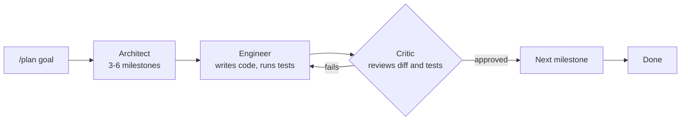

<div align="center">



<br>

**An AI engineer that lives in your terminal. It plans, codes, tests and ships, and you can undo any change with one command.**

[](https://www.npmjs.com/package/ignite-agent)
[](https://www.python.org/)
[](LICENSE)
[](#quickstart)
[](#multi-agent-swarm)

[Quickstart](#quickstart) · [Swarm](#multi-agent-swarm) · [Safety](#gitshield-and-rollbacks) · [Commands](#slash-commands) · [Tools](#the-18-agent-tools) · [API keys](#api-keys)

</div>

---

## Why IGNITE

| | |
|---|---|
| **Never stops on a quota error** | Routes across Gemini, Groq, Mistral, Cohere and OpenRouter. If a provider returns `429`, it is blocked for the session and the next one takes over. |
| **Plans big goals** | A swarm of three agents (Architect, Engineer, Critic) breaks a goal into milestones and checks each one. |
| **Safe by default** | A snapshot is saved before every task. Run `/undo` to restore it. |
| **Catches bad code early** | Every Python write or patch is checked by the AST parser before it touches disk. |
| **Fixes its own failures** | Runs your tests, reads the traceback, patches the bug and runs them again. |
| **Finds things fast** | Built-in code search using SQLite FTS5 BM25 and AST symbols. No vector database needed. |
| **Extensible** | Works as an MCP client, so it can use filesystem, SQLite, GitHub and Puppeteer servers. |
| **Observable** | A live web dashboard shows token use, cost, processes and logs. |

---

## Quickstart

### Option 1: npm (recommended)

```bash
npm install -g ignite-agent
```

Or run it once with no install:

```bash
npx ignite-agent
```

Then open any project folder and start it:

```bash
ignite
```

On first launch, a setup wizard asks for your API keys. **You only need one** (a free Gemini or Groq key is enough). Run it again any time with `ignite setup`, or type `/setup` inside the chat.

### Option 2: from source

```bash
git clone https://github.com/im-ignite/ignite-agent.git
cd ignite-agent
pip install -r requirements.txt
python ignite_agent.py
```

> **Requires** Python 3.10 or newer. Git is needed for GitShield and `/diff`.

---

## Multi-agent swarm

For large goals, IGNITE splits the work between three agents.



| Agent | Job |
|---|---|
| **The Architect** | Breaks the goal into 3–6 milestones, each with clear acceptance criteria. |
| **The Engineer** | Writes files, runs commands, builds assets and runs tests. |
| **The Critic** | Reviews diffs, runs the test suite and sends failures back for fixes before approving a milestone. |

```text
IGNITE> /plan build a full-stack authentication system with JWT and SQLite
IGNITE> /swarm off     # run tasks directly, without the swarm
IGNITE> /swarm on
```

---

## GitShield and rollbacks

Changes can always be reverted.

```text
IGNITE> /undo          # restore the pre-task snapshot
IGNITE> /diff          # colorized diff of uncommitted changes
IGNITE> /verify        # run the self-healing test runner
IGNITE> /checkpoint    # save a manual snapshot
```

- **Automatic checkpoints.** A shadow snapshot is taken before any task runs.
- **Syntax gatekeeper.** Invalid Python is rejected before it is written.
- **Self-healing tests.** `pytest`, `unittest`, `npm test` and compiler checks are detected and run. On failure, IGNITE reads the traceback, patches the code and verifies again.

---

## Code search

IGNITE indexes your project so it can find code by meaning, not just by file name.

- Indexes `.py`, `.js`, `.ts`, `.html`, `.css`, `.json`, `.yaml` and more with **SQLite FTS5 BM25** ranking.
- Extracts classes, functions, methods and docstrings from the Python AST.
- Updates incrementally in under 0.1 seconds.

```text
IGNITE> /index             # incremental sync
IGNITE> /index rebuild     # full re-index
IGNITE> /search verify_token
```

---

## Model Context Protocol (MCP)

IGNITE is an MCP client. It talks to MCP servers over stdio using JSON-RPC 2.0, so you can add tools from filesystem, database and API servers.

```text
IGNITE> /mcp init      # create a starter .ignite_mcp.json
IGNITE> /mcp list      # list tools from all configured servers
IGNITE> /mcp status    # check that background servers are connected
```

Servers are configured in `.ignite_mcp.json` in your project folder.

---

## Live dashboard

```text
IGNITE> /dashboard
```

Opens `http://localhost:7860` with:

- Real-time token use and estimated cost
- Background process status and log streams
- Session history and memory inspection

---

## Slash commands

| Command | What it does |
|---|---|
| `/plan [goal]` | Run the swarm: Architect, then Engineer, then Critic |
| `/swarm [on\|off]` | Turn swarm mode on or off |
| `/index [rebuild]` | Sync or rebuild the code index |
| `/search <query>` | Search functions, classes and code chunks |
| `/mcp [list\|init\|status]` | Manage MCP servers and tools |
| `/undo`, `/rollback` | Restore the pre-task snapshot |
| `/diff [file]` | Show a colorized git diff |
| `/verify [cmd]` | Run the self-healing test runner |
| `/commit [msg]` | Stage and commit all changes |
| `/checkpoint` | Save a manual snapshot |
| `/dashboard`, `/ui` | Open the web dashboard on `localhost:7860` |
| `/model [num]` | Pick a model (arrow keys or 1–9) |
| `/deploy [target]` | Deploy to Railway, Fly, Docker or Render |
| `/memory` | Inspect episodic memory and context tokens |
| `/ps`, `/kill <pid>` | List and stop background processes |
| `/tools` | Show all 18 agent tools |
| `/clear` | Clear the chat but keep what it has learned |

---

## The 18 agent tools

| Tool | Purpose |
|---|---|
| `terminal` | Run PowerShell commands with live output |
| `file_read` | Read files with line ranges |
| `file_write` | Create or write files, with AST syntax check |
| `file_patch` | Apply surgical unified diffs |
| `git` | Full git repository management |
| `git_diff` | Inspect working tree changes |
| `verify_code` | Self-healing test runner |
| `python_eval` | Evaluate Python in an isolated session |
| `spawn` | Start background workers or visible terminal windows |
| `kill` | Stop processes by PID or name |
| `process_status` | Check process health and memory |
| `read_log` | Stream stdout and stderr from background processes |
| `search` | Web search (DuckDuckGo, with Bing fallback) |
| `code_search` | Hybrid BM25 and AST symbol search |
| `mcp_call` | Call external MCP tools |
| `deploy` | Scaffold and deploy to the cloud |
| `ask` | Pause and ask you for a decision or credential |
| `done` | Finish the task or answer directly |

---

## API keys

You need **at least one** key. IGNITE reads keys from environment variables on startup. The setup wizard (`ignite setup`) can configure them for you.

| Provider | Variable(s) | Get a key |
|---|---|---|
| Google Gemini (primary) | `GEMINI_API_KEY`, `GEMINI_API_KEY_2`, `GEMINI_API_KEY_3` | [Google AI Studio](https://aistudio.google.com/) |
| Groq | `GROQ_API_KEY`, `GROQ_API_KEY_2` | [Groq Console](https://console.groq.com/) |
| Mistral | `MISTRAL_API_KEY` | [Mistral Console](https://console.mistral.ai/) |
| Cohere | `COHERE_API_KEY` | [Cohere Dashboard](https://dashboard.cohere.com/) |
| OpenRouter | `OPENROUTER_API_KEY` | [OpenRouter](https://openrouter.ai/) |

Extra Gemini and Groq keys are used as quota fallbacks.

<details>
<summary><b>Windows PowerShell (saved permanently)</b></summary>

Keys are stored in your Windows user registry. They survive restarts and are never saved in repository files.

```powershell
[Environment]::SetEnvironmentVariable("GEMINI_API_KEY", "your_key_here", "User")
[Environment]::SetEnvironmentVariable("GROQ_API_KEY", "your_key_here", "User")
[Environment]::SetEnvironmentVariable("MISTRAL_API_KEY", "your_key_here", "User")
[Environment]::SetEnvironmentVariable("COHERE_API_KEY", "your_key_here", "User")
[Environment]::SetEnvironmentVariable("OPENROUTER_API_KEY", "your_key_here", "User")
```

Restart your terminal, then check a key:

```powershell
[Environment]::GetEnvironmentVariable("GEMINI_API_KEY", "User")
```

</details>

<details>
<summary><b>macOS / Linux</b></summary>

Add to `~/.bashrc` or `~/.zshrc`:

```bash
export GEMINI_API_KEY="your_key_here"
export GROQ_API_KEY="your_key_here"
```

Then run `source ~/.zshrc` (or open a new terminal).

</details>

<details>
<summary><b>Using a .env file</b></summary>

```bash
cp .env.example .env      # PowerShell: Copy-Item .env.example .env
```

Fill in your keys in `.env`. The file is already in `.gitignore`, so it won't be committed.

</details>

> **Keep your keys private.** Never paste them into issues, screenshots or commits.

---

## Contributing

Issues and pull requests are welcome. For larger changes, open an issue first so we can talk it through.

1. Fork the repo and create a branch.
2. Make your change and run `/verify` inside IGNITE (or your test suite).
3. Open a pull request that describes what changed and why.

---

## License

IGNITE is released under the [MIT License](LICENSE).

<div align="center">

If IGNITE saves you time, a star on the repo helps others find it.

</div>
